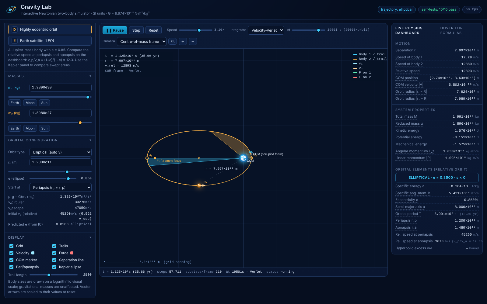
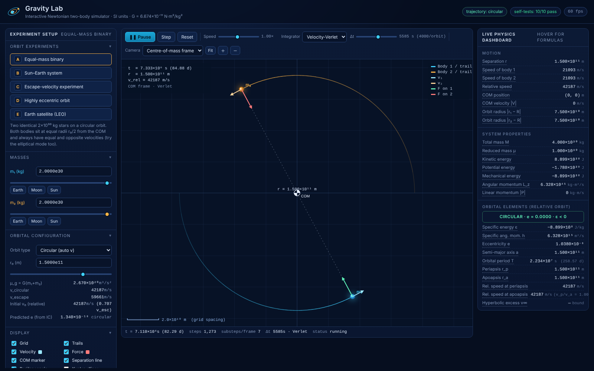
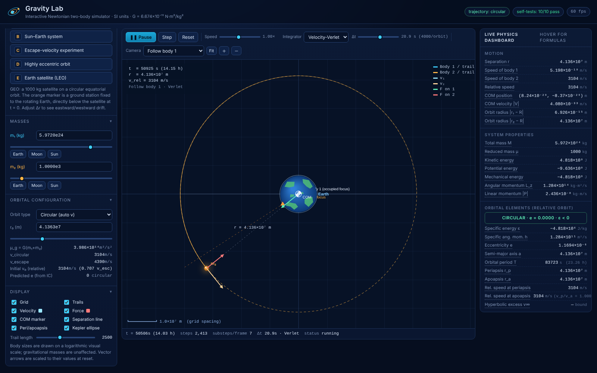
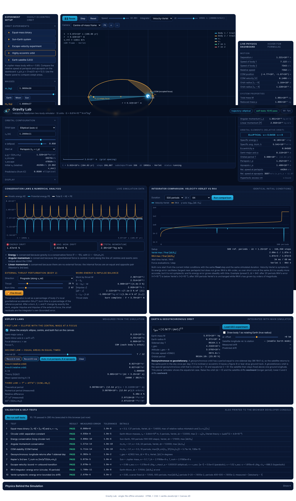

# Gravity Lab — Interactive Two-Body Gravitational Simulator

**ME 206 (Statics and Dynamics) — supplementary submission**

Gravity Lab is an interactive simulator of the Newtonian two-body problem. Both masses move under their mutual gravitational attraction F = G m₁ m₂ / r² (neither body is fixed), integrated numerically in SI units with G = 6.674×10⁻¹¹ N·m²/kg². It shows live conservation laws, orbital elements, Kepler's three laws and a geosynchronous-orbit experiment, and it checks its own physics with automated self-tests.

- **Live interactive GUI:** `https://gurparassingh37.github.io/ME206-Assignment4/q2_gravity_lab/` (see [Hosting on GitHub Pages](#hosting-on-github-pages-interactive-gui-link))
- **Single file:** everything (HTML, CSS, JavaScript) is in [`gravity_lab.html`](gravity_lab.html). No libraries, no build step, works offline.



---

## 1. Software requirements

| Purpose | Requirement |
|---|---|
| Run the simulator | Any modern web browser: Chrome / Edge 90+, Firefox 90+ or Safari 15+. JavaScript must be enabled. |
| Run the self-tests from the command line (optional) | [Node.js](https://nodejs.org) 16 or newer |
| Dependencies | **None.** No npm packages, CDNs, frameworks or internet connection are needed. |

The simulator uses only HTML5, CSS, vanilla JavaScript and the Canvas 2D API.

---

## 2. How to run the simulation

### Option A: open the file directly (simplest)
1. Download or clone this repository:
   ```bash
   git clone https://github.com/gurparassingh37/ME206-Assignment4/q2_gravity_lab.git
   cd ME206-Assignment4/q2_gravity_lab
   ```
   (Or click **Code → Download ZIP** on GitHub and unzip it.)
2. Double-click **`gravity_lab.html`** (or `index.html`, which is an identical copy). It opens in your default browser.
3. The simulation starts with experiment **A (equal-mass binary)**. Press **▶ Play / ❚❚ Pause** to control it.

### Option B: serve it locally (optional)
```bash
python3 -m http.server 8000
# then open http://localhost:8000/gravity_lab.html
```

### Run the automated self-tests
The tests run automatically every time the page loads. The results appear in the **Validation & self-tests** table at the bottom of the page and in the browser developer console (F12 → Console).

To run the same tests from a terminal:
```bash
node tests/run_tests.js
```
The runner extracts the physics engine from `gravity_lab.html`, executes all tests, prints PASS/FAIL with the measured error and tolerance for each, and exits with code 0 only if every test passes.

---

## 3. Quick usage guide

1. **Choose an experiment** (A–E) in the left panel, or set the masses m₁ and m₂, the initial separation r₀ and the orbit type (circular / elliptical / parabolic / hyperbolic / manual velocity). Any change rebuilds consistent initial conditions in the centre-of-mass frame.
2. **Simulation controls** (top bar): Play/Pause, Step (one Δt), Reset, simulation speed, integrator (Velocity-Verlet or RK4) and time step Δt.
3. **Camera:** centre-of-mass frame, follow body 1, or fixed inertial frame. Mouse wheel zooms, dragging pans, **Fit** auto-fits the orbit. Checkboxes toggle the grid, trails, velocity and force vectors, COM marker, separation line, periapsis/apoapsis markers and Kepler ellipse.
4. **Live dashboard** (right): separation, speeds, COM position and velocity, energies, angular and linear momentum, and orbital elements (ε, e, a, T, r_p, r_a). Hover over any label to see its formula. The trajectory type is classified from the computed e and ε, not from the chosen preset.
5. **Analysis panels** (below the canvas): energy graph, conservation indicators, external-thrust perturbation with work–energy balance, Verlet-vs-RK4 comparison, Kepler's laws, the Earth/GEO experiment and the self-test table.

Keyboard shortcuts: `Space` play/pause · `R` reset · `F` fit view · `.` single step.

### Experiment presets

| | Experiment | What it demonstrates |
|---|---|---|
| A | Equal-mass binary | Equal orbital radii about the COM, equal and opposite velocities and forces |
| B | Sun–Earth system | A light planet about a heavy star; the Sun still circles the COM (≈ 450 km) |
| C | Escape velocity | The v₀/v_esc slider sweeps the trajectory from elliptical to parabolic to hyperbolic |
| D | Highly eccentric orbit (e = 0.85) | Speed at periapsis vs apoapsis (v_p/v_a ≈ 12.3); Kepler's 2nd and 3rd laws |
| E | Earth satellite (LEO, 420 km) | Orbital properties of a satellite around a to-scale, rotating Earth |
| GEO | Load GEO experiment button | The satellite stays above a ground station; Δr produces eastward/westward drift |

---

## 4. Physics and numerical methods

| Equation | Where it is implemented (`gravity_lab.html`) |
|---|---|
| F = G m₁m₂/r²; a₁ = +G m₂ **r**/r³, a₂ = −G m₁ **r**/r³ | `gravAcc` |
| COM-frame initial conditions: **r**₁ = −(m₂/M)**r**, **r**₂ = (m₁/M)**r**, total **P** = 0 | `initialState` |
| μ_g = G(m₁+m₂), v_c = √(μ_g/r₀), v_esc = √(2μ_g/r₀) | `characteristicSpeeds` |
| Vis-viva speed at an apse: v = √(μ_g(1 ± e)/r₀) | `autoSpeed` |
| Velocity-Verlet (kick–drift–kick) | `Simulation._verlet` |
| Classical 4th-order Runge–Kutta | `Simulation._rk4` |
| KE = ½m₁v₁² + ½m₂v₂², PE = −Gm₁m₂/r, E, L, P, COM R and V | `diagnostics` |
| ε = v²/2 − μ_g/r, h = \|**r**×**v**\|, eccentricity vector, a = −μ_g/2ε, r_p, r_a, T = 2π√(a³/μ_g) | `elementsFromRel` |
| Work W = ∫**F**·**v** dt, impulse J = ∫**F** dt, angular impulse ∫**r**×**F** dt | `Simulation._singleStep` |
| Kepler II: dA = ½\|**r** × d**r**\| | `SectorRecorder.update` |
| Numerical period (time for **r** to sweep 2π) | `PeriodTracker.update` |
| r_geo = [G M T² / 4π²]^(1/3) | `geoRadius` |
| GEO longitude drift = 360°(T_sid / T − 1) per sidereal day | `updateGeo` |

**Integration.** Velocity-Verlet (default) is second-order, time-reversible and symplectic. It conserves linear and angular momentum to round-off for central forces, and its energy error stays bounded. RK4 is fourth-order but not symplectic, so its energy error grows over long runs (see the comparison panel). Several physics sub-steps are taken per animation frame. As a close-approach safety net, a step is subdivided only if Δt > 0.3·√(r³/μ_g). The simulation halts cleanly on a collision or numerical overflow.

The full theory, with equations, is in the collapsible **"Physics Behind the Simulation"** section at the bottom of the page.

---

## 5. Validation (self-test results)

Output of `node tests/run_tests.js`:

| # | Test | Result | Measured error | Tolerance |
|---|---|---|---|---|
| 1 | Equal-mass binary: equal radii about the COM, v₁ = −v₂ | PASS | 0 | 1×10⁻⁹ |
| 2 | Circular orbit: separation constant (Verlet theory (ωΔt)²/2 = 4.9×10⁻⁶) | PASS | 4.94×10⁻⁶ | 1×10⁻⁵ |
| 3 | Energy conservation, 100 circular orbits | PASS | 3.90×10⁻¹⁰ | 1×10⁻⁶ |
| 4 | Angular momentum conservation, e = 0.6 | PASS | 1.57×10⁻¹⁴ | 1×10⁻¹⁰ |
| 5 | COM stability in the COM frame | PASS | 5.71×10⁻¹⁴ | 1×10⁻¹⁰ |
| 6 | Geosynchronous longitude after one sidereal day (degrees) | PASS | 6.4×10⁻⁵ | 1×10⁻² |
| 7 | Kepler's 3rd law, analytical vs numerical period | PASS | 5.87×10⁻⁵ | 1×10⁻⁴ |
| 8 | Escape velocity: bound ↔ unbound transition | PASS | 3.08×10⁻⁵ | 1×10⁻⁴ |
| 9 | RK4 energy error, circular orbit | PASS | 1.71×10⁻¹¹ | 1×10⁻⁸ |
| 10 | Verlet energy error stays bounded over 500 orbits | PASS | 2.7×10⁻⁶ | 5×10⁻² |

Note: r_geo is computed as 42 163.1 km from G = 6.674×10⁻¹¹ and M = 5.972×10²⁴ kg exactly as specified, slightly different from the commonly quoted 42 164 km, which uses the more precise product GM = 3.986004×10¹⁴ m³/s².

---

## 6. Repository structure

```
.
├── gravity_lab.html      # complete simulator (physics engine + GUI + self-tests)
├── index.html            # identical copy, so GitHub Pages serves it at the site root
├── tests/
│   └── run_tests.js      # command-line self-test runner (Node.js, no dependencies)
├── docs/                 # screenshots
│   ├── binary.png
│   ├── eccentric_kepler.png
│   ├── geo.png
│   └── analysis.png
└── README.md
```

Inside `gravity_lab.html` the code is split into clearly marked sections:

1. **Physics engine** (`<script id="physics-engine">`, no DOM access): constants, gravitational acceleration, initial conditions, `Simulation` class (Verlet, RK4, thrust, safety guards), `diagnostics`, orbital observers and `runSelfTests`.
2. **UI state, controls and presets**
3. **Data buffers** (trail ring buffer, energy history)
4. **Visualization** (Canvas 2D rendering, energy graph, dashboard, Kepler and GEO panels)
5. **Integrator comparison**
6. **Self-test UI**
7. **Main animation loop**

---

## Hosting on GitHub Pages (interactive GUI link)

1. Push this repository to GitHub.
2. Go to **Settings → Pages**.
3. Under **Build and deployment**, set **Source: Deploy from a branch**, **Branch: `main`**, folder **`/ (root)`**, then click **Save**.
4. After about a minute the simulator is live at `https://gurparassingh37.github.io/ME206-Assignment4/q2_gravity_lab/`. Submit this link as the interactive GUI link.

---

## Screenshots

| Equal-mass binary | Geosynchronous orbit |
|---|---|
|  |  |


